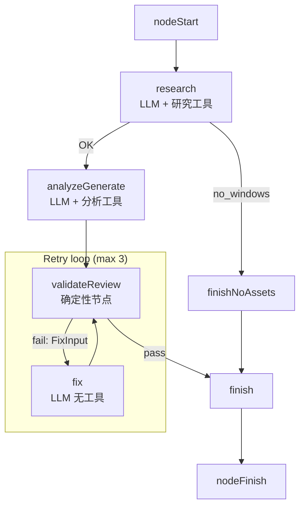

# 架构重构方案：generate + refine 分离循环

## 1. 背景

### 当前架构（重构前）

```
Research(LLM) → Analyze(LLM) → PrepareManifest(确定性) → GenerateWithRetry(LLM + condition)
```

四个步骤，三个 LLM session，问题：

| 问题 | 影响 |
|------|------|
| Generate LLM 增量价值极低（只是读骨架+输出+微调 description） | 浪费一次 LLM session（~$0.02/次，30-60s） |
| `subgraphWithRetry` 每次 retry 重置 LLM 上下文 | LLM 看不到之前的 feedback，重复同样错误 |
| 确定性骨架无法传达设计意图 | LLM 误改正确的 bin/extract_dir |
| validate 做了语义判断（GuiBin） | 误删 electerm 等 dual-mode app 的 bin |
| review 在 condition 中消耗 retry 预算 | laragon retry 3 次耗尽返回 `{}` |
| maxRetries=5 才能勉强覆盖 validate+review | token 和时间成本高 |

### 目标架构

```
research(LLM, 研究工具)
    ↓ ResearchOutput
generate(LLM, 分析工具: hash/archive/installer)
    ↓ manifest JSON (完整 manifest + finalize_task_result)
verify(确定性节点: validate() + review)
    ↓ [通过]                              ↓ [不通过: RefineContext]
nodeFinish                             refine(LLM, 无工具)
                                           ↓ refined manifest
                                       verify
                                           ↓ [通过 / 再修，max 3 次]
```

三个步骤，两个 LLM session（research + generate），refine 只有在需要时才调用。

### 参考模式

来自 Koog 的 CustomStrategy 示例（`examples/simple-examples/.../CustomStrategy.kt`）：

```kotlin
val generate  by subgraphWithTask<Unit, String>(...)
val verify    by subgraphWithVerification<String>(...)
val fix       by subgraphWithTask<CriticResult<String>, String>(...)

edge(generate forwardTo verify)
edge(verify forwardTo fix onCondition { !it.successful })
edge(verify forwardTo nodeFinish onCondition { it.successful })
edge(fix forwardTo verify)  // ← 循环
```

关键洞察：Koog **允许 edge 形成条件循环**（`verify → fix → verify`），不需要 `subgraphWithRetry`。

---

## 2. 架构详图

```
                                  ┌─────────────────────────────────────┐
                                  │          Refine loop (max 3)        │
                                  │                                     │
nodeStart → research → generate → verify ── [pass] ──→ nodeFinish
                          ↑          │                            ↑
                          │       [fail: RefineContext]           │
                          │          ↓                            │
                          └──────── refine ──────────────────────┘
                                       │
                                       │ (3 次后仍失败 → nodeFinish)
                                       └────────────────────────────┘
```

### 节点说明

| 节点 | 类型 | 输入 | 输出 | 说明 |
|------|------|------|------|------|
| `research` | `subgraphWithTask` | `String` (URL) | `ResearchOutput` | 不变：研究工具 + 结构化输出 |
| `generate` | `subgraphWithTask` | `ResearchOutput` | `String` (manifest JSON) | 合并：分析工具 + 直接输出完整 manifest |
| `verify` | `node` (确定性) | `String` (manifest) | `RefineContext?` (null = 通过) | validate() + review：结构检查 + 语义审查 |
| `refine` | `subgraphWithTask` | `RefineContext` | `String` (refined manifest) | 轻量精炼：无工具，只看 feedback + manifest |

### 数据类型

```kotlin
// verify 的输出：null 表示通过，RefineContext 表示需要精炼
data class RefineContext(
    val manifest: String,       // 当前 manifest（含问题）
    val feedback: String,       // 累积的问题描述
    val retryCount: Int,        // 当前精炼次数
)

// generate 的输出（通过 finalize_task_result 产出）
// 类型：String（完整 manifest JSON）
```

---

## 3. 详细设计

### 3.1 research 阶段（不变）

```
输入：URL (String)
输出：ResearchOutput (JSON)
工具：fetchRepoInfo, fetchLatestRelease, fetchFileContent, fetchWebPage,
      fetchJson, searchTextInArchive, __ask_user__ 等
Prompt：保持不变（PhasePrompts.buildResearchPrompt）
```

### 3.2 generate 阶段（合并 research 结果 + 分析 + 生成）

```
输入：ResearchOutput
输出：String（完整 manifest JSON，通过 finalize_task_result 产出）
工具：computeSha256FromUrl, listArchiveContents, findExecutables,
      detectInstallerType, __ask_user__
Prompt：合并 analyze + generate 逻辑
```

#### generate Prompt 结构

```
你是 Scoop manifest 生成器。基于研究结果，请：

1. 用 computeSha256FromUrl 计算每个资产的 hash
2. 用 listArchiveContents + findExecutables 检查压缩包内容
3. 用 detectInstallerType 确定安装器类型
4. 确定 bin、shortcuts、persist、extract_dir、pre_install 等
5. 根据 installer type 应用 URL 转换：
   - NSIS: URL 后加 #/dl.7z
   - portable EXE: URL 后加 #/app.exe
   - InnoSetup: 添加 "innosetup": true
6. 添加 checkver（GitHub 格式 {"github":"https://github.com/..."}）
7. 添加 autoupdate（URL 模板，version→$version）
8. 如果研究结果中有 checksums_filename，添加 autoupdate.hash

## 研究结果
{research JSON}

## 参考 Manifest
{ReferenceManifests.ALL}

## bin 规则
- versioned exe: set versioned_bin=true, bin_aliases=["shortname"]
  使用 per-architecture bin: "64bit": {"bin": [["app-1.2.3-x64.exe", "app"]]}
- 不要用 pre_install + Rename-Item 处理版本化 exe

## 输出
完成后调用 finalize_task_result 输出完整 manifest JSON
```

### 3.3 verify 节点（确定性）

```kotlin
val validateReview by node<String, FixInput?>("validateReview") { manifest ->
    val errors = mutableListOf<String>()

    // Step 1: Structural validate (cheap, deterministic)
    if (manifestIo != null) {
        val validateJson = manifestIo.validate(manifest)
        val obj = Json.parseToJsonElement(validateJson).jsonObject
        if (obj["valid"]?.jsonPrimitive?.content != "true") {
            obj["errors"]?.jsonArray?.forEach {
                errors.add(it.jsonPrimitive.content)
            }
        }
        // Also collect warnings for reference
        obj["warnings"]?.jsonArray?.forEach {
            logger.info { "[validate] Warning: ${it.jsonPrimitive.content}" }
        }
    }

    // Step 2: Semantic review (expensive, LLM-based)
    // Only run review when validate passes (structural OK)
    if (errors.isEmpty() && reviewExecutor != null) {
        try {
            val reviewJson = reviewExecutor(manifest)
            val reviewObj = Json.parseToJsonElement(reviewJson).jsonObject
            if (reviewObj["approved"]?.jsonPrimitive?.content != "true") {
                reviewObj["issues"]?.jsonArray?.forEach { issue ->
                    val severity = issue.jsonObject["severity"]?.jsonPrimitive?.content ?: "warning"
                    if (severity == "error") {
                        val msg = issue.jsonObject["message"]?.jsonPrimitive?.content ?: "unknown"
                        errors.add(msg)
                    }
                }
            }
        } catch (e: Exception) {
            logger.warn { "[review] Review agent error: ${e.message}" }
        }
    }

    if (errors.isNotEmpty()) {
        val currentRetry = (storage.get(retryCountKey) ?: 0) + 1
        storage.set(retryCountKey, currentRetry)
        FixInput(
            manifest = manifest,
            feedback = errors.joinToString("\n- ", "- "),
            retryCount = currentRetry,
        )
    } else {
        null  // 通过
    }
}
```

#### 保留的结构检查

从 validate 中移除语义判断（移到 review），保留纯结构检查：

| 保留（结构检查） | 移除（语义判断） |
|-----------------|-----------------|
| JSON 语法 | `validateGuiBin`（GUI vs CLI） |
| 必填字段: version, license, url/architecture | `validatePersistPolicy`（persist 合理性） |
| 字段类型: hash 64 hex, url http | |
| pre_install Rename-Item（结构错误） | |
| MSI extract_dir backslashes | |
| bin 位置检查（去掉 topLevelOnly 中的 bin） | |

#### parseReviewErrors helper

```kotlin
private fun parseValidateErrors(validateJson: String): List<String> {
    val obj = Json.parseToJsonElement(validateJson).jsonObject
    if (obj["valid"]?.jsonPrimitive?.content == "true") return emptyList()
    return obj["errors"]?.jsonArray
        ?.mapNotNull { it.jsonPrimitive.content.takeIf { c -> c.isNotBlank() } }
        ?: emptyList()
}

private fun parseReviewErrors(reviewJson: String): List<String> {
    val obj = Json.parseToJsonElement(reviewJson).jsonObject
    if (obj["approved"]?.jsonPrimitive?.content == "true") return emptyList()
    return obj["issues"]?.jsonArray
        ?.filter { it.jsonObject["severity"]?.jsonPrimitive?.content == "error" }
        ?.mapNotNull { it.jsonObject["message"]?.jsonPrimitive?.content }
        ?: emptyList()
}
```

### 3.4 refine 阶段（轻量，仅精炼）

```
输入：RefineContext { manifest, feedback, retryCount }
输出：String (refined manifest JSON)
工具：无（或仅 __ask_user__）
Prompt：小、聚焦只修正列出的问题
```

#### refine Prompt

```kotlin
fun buildRefinePrompt(ctx: RefineContext): String = """
You are a Scoop manifest refiner. The manifest below has validation/review issues.
Fix ONLY the listed issues. Do NOT change anything else.

## Issues to Fix
${ctx.feedback}

## Current Manifest
```json
${ctx.manifest}
```

## Rules
- Fix each listed issue exactly as described
- Do NOT reorganize or rewrite the manifest
- Do NOT add, remove, or rename fields not mentioned in the issues
- After fixing, call finalize_task_result with the corrected manifest

## Attempt
${ctx.retryCount} / 3
""".trimIndent()
```

### 3.5 Strategy 完整代码

```kotlin
fun scoopManifestStrategy(
    researchTools: List<ToolBase<*, *>>,
    analyzeTools: List<ToolBase<*, *>>,
    llmParams: LLMParams?,
    researchPromptBuilder: (suspend (String) -> String)?,
    generateManifestPromptBuilder: (suspend (ResearchOutput) -> String)?,
    refinePromptBuilder: (suspend (RefineContext) -> String)?,
    manifestIo: ManifestIo?,
    reviewExecutor: (suspend (String) -> String)?,
) = strategy<String, ManifestResult>("scoop_manifest_v2") {

    val retryCountKey = createStorageKey<Int>("refine_retry_count")
    val maxRetries = 3

    var researchData: ResearchOutput? = null
    var suggestedAppName: String? = null
    var finalManifest: String? = null

    // ── research ──
    val research by subgraphWithTask<String, ResearchOutput>(
        tools = researchTools,
        llmParams = llmParams,
    ) { input -> researchPromptBuilder?.invoke(input) ?: input }

    // ── generate ──
    val generate by subgraphWithTask<ResearchOutput, String>(
        tools = analyzeTools,
        llmParams = llmParams,
    ) { research ->
        researchData = research
        suggestedAppName = research.suggested_app_name
        storage.set(retryCountKey, 0)
        generateManifestPromptBuilder?.invoke(research) ?: ""
    }

    // ── refine ──
    val refine by subgraphWithTask<RefineContext, String>(
        tools = emptyList(),
        llmParams = llmParams,
    ) { input -> refinePromptBuilder?.invoke(input) ?: "" }

    // ── verify ──
    val verify by node<String, RefineContext?>("verify") { manifest ->
        finalManifest = manifest
        val errors = mutableListOf<String>()

        // Validate
        if (manifestIo != null) {
            try {
                errors.addAll(parseValidateErrors(manifestIo.validate(manifest)))
            } catch (e: Exception) {
                errors.add("Validate error: ${e.message}")
            }
        }

        // Review (only if validate passes)
        if (errors.isEmpty() && reviewExecutor != null) {
            try {
                errors.addAll(parseReviewErrors(reviewExecutor(manifest)))
            } catch (_: Exception) { }
        }

        if (errors.isNotEmpty()) {
            val currentRetry = (storage.get(retryCountKey) ?: 0) + 1
            storage.set(retryCountKey, currentRetry)
            RefineContext(manifest = manifest, feedback = errors.joinToString("\n- ", "- "), retryCount = currentRetry)
        } else {
            null
        }
    }

    // ── Edges ──
    edge(nodeStart forwardTo research)

    // No Windows assets → early exit
    val finishNoAssets by node<ResearchOutput, ManifestResult>("finishNoAssets") { r ->
        ManifestResult(manifest = "", suggestedAppName = r.suggested_app_name, noAssets = true)
    }
    edge(research forwardTo finishNoAssets onCondition { it.status == ResearchStatus.NO_WINDOWS_ASSETS })
    edge(research forwardTo generate onCondition { it.status == ResearchStatus.OK })
    edge(finishNoAssets forwardTo nodeFinish)

    edge(generate forwardTo verify)

    // Refine loop: fail → refine → verify
    edge(verify forwardTo refine onCondition { ctx ->
        ctx != null && ctx.retryCount <= maxRetries
    })
    edge(refine forwardTo verify)

    // Pass → finish
    edge(verify forwardTo nodeFinish onCondition { it == null } transformed {
        ManifestResult(
            manifest = extractJsonBlock(finalManifest!!) ?: finalManifest!!,
            suggestedAppName = suggestedAppName,
        )
    })

    // Exhausted → finish (return last manifest with issues)
    edge(verify forwardTo nodeFinish onCondition { it != null && it.retryCount > maxRetries } transformed {
        logger.warn { "[strategy] Refine exhausted after ${maxRetries} attempts. Returning last manifest with issues." }
        ManifestResult(
            manifest = extractJsonBlock(finalManifest!!) ?: finalManifest!!,
            suggestedAppName = suggestedAppName,
        )
    })
}
```

---

## 4. 数据流

### 第一次通过

```
research:           "https://github.com/owner/repo"
    ↓
generate:           receive ResearchOutput
                    call computeSha256FromUrl
                    call listArchiveContents
                    call findExecutables
                    call detectInstallerType
                    write manifest JSON
                    finalize_task_result → manifest JSON string
    ↓
verify:             validate(manifest) → []
                    review(manifest) → []
                    → null (通过)
    ↓
nodeFinish:         ManifestResult(manifest, suggestedAppName)
```

### 精炼循环

```
verify:             review(manifest) → [error: "checkver missing"]
                    → RefineContext(manifest, "checkver missing", 1)
    ↓
refine:             receive RefineContext
                    prompt: "Issues: checkver missing\nCurrent: {...}"
                    LLM adds checkver, calls finalize_task_result
                    → refined manifest JSON string
    ↓
verify:             validate(fixed) → []
                    review(fixed) → [error: "bin conflicts with shortcuts"]
                    → RefineContext(fixed, "bin conflicts with shortcuts", 2)
    ↓
refine:             receive RefineContext
                    prompt: "Issues: bin conflicts with shortcuts\nCurrent: {...}"
                    LLM deletes bin, calls finalize_task_result
                    → refined manifest JSON string
    ↓
verify:             validate(fixed) → []
                    review(fixed) → []
                    → null (通过)
    ↓
nodeFinish:         ManifestResult(fixedManifest, suggestedAppName)
```

### 耗尽

```
retryCount = 4
verify → RefineContext(..., 4)
edge(verify forwardTo refine onCondition { retryCount ≤ 3 }) → false
edge(verify forwardTo nodeFinish onCondition { retryCount > 3 }) → true
→ 返回最后一个 manifest（可能仍有问题）
```

---

## 5. 与当前方案对比

| | 当前 | 重构后 |
|---|---|---|
| LLM session 数 | 3 + retry×N | 2 + refine×N（refine 无工具，极轻量） |
| Retry 时分析工具重跑 | 否（骨架已固定） | 否（refineManifest 不跑分析工具） |
| 上下文保留 | ✗（subgraphWithRetry reset） | ✓（新 LLM session + feedback in prompt） |
| 确定性骨架 | ✓（assembleManifestSkeleton） | ✗（LLM 直接写 manifest） |
| checkver/autoupdate 保证 | 确定性代码生成 | review 检查 |
| per-arch bin | 确定性代码处理 | LLM 生成，review 检查 |
| 架构复杂度 | 4 phase，1 retry wrapper | 3 phase，edge 循环 |
| 代码量 | ScoopManifestStrategy ~170 行 | ScoopManifestStrategy ~120 行 |

---

## 6. 风险与应对

| 风险 | 应对 |
|------|------|
| LLM 生成 checkver 格式错误 | review rule #9 检查 checkver 存在；validate 检查 autoupdate 结构 |
| LLM 用错 $version 替换 | review 检查 autoupdate URL 模板；refineManifest 重新修正 |
| LLM 输出 `{"status":"ok","manifest":"{...}"}` 包装 | validate + extractJsonBlock 解包；formatManifest 自动解包 |
| refine 后仍然有问题 | max 3 次精炼；仍失败则 log warning + 返回最后版本 |
| generateManifest 偶发崩溃 | 不修复；与问题无关（research 阶段失败属 LLM API 偶发错误） |
| LLM 在 refine 中改动与问题无关的字段 | refine prompt 强调"ONLY fix listed issues, change nothing else" |

---

## 7. 实施清单

### 新增文件

| 文件 | 说明 |
|------|------|
| （无） | 所有改动在现有文件中 |

### 修改文件

| 文件 | 改动 |
|------|------|
| `ScoopManifestStrategy.kt` | 完全重写：research + analyzeGenerate + fix + validateReview，edge 循环 |
| `ScoopManifestGenerator.kt` | - 删除 `generatePromptBuilder`<br>- 新增 `analyzeGeneratePromptBuilder`、`fixPromptBuilder`<br>- 删除 `generateTools`、`expandedToolRegistry`<br>- `toolRegistry` 不再需要包含 review tool |
| `PhasePrompts.kt` | - 删除 `buildGeneratePrompt()`<br>- 新增 `buildAnalyzeGeneratePrompt()`（合并 analyze + generate）<br>- 新增 `buildFixPrompt()`（轻量修复） |
| `PhaseTools.kt` | - 删除 `GENERATE_TOOL_NAMES`<br>- 保留 `VALIDATE` 和 `REVIEW_MANIFEST` 常量（review 在 condition 中使用，不是 tool） |
| `PhaseSchemas.kt` | - 删除 Generate schema<br>- Analyze schema 扩展（versioned_bin, bin_aliases, installer_type 等保留） |
| `DefaultToolRegistryFactory.kt` | - 移除 `DYNAMIC_TOOL_NAMES`<br>- 移除 `validatePhaseCoverage` 对 `GENERATE_TOOL_NAMES` 的引用 |
| `FileManifestIo.kt` | - `validateGuiBin` 改为 warning only（不再 error）<br>- 保留 `validatePreInstallRename`（结构错误，仍然是 error）<br>- review 处理其他语义判断 |
| `Types.kt` | 添加 `FixInput` data class |

### 删除/废弃

| 文件/函数 | 原因 |
|------|------|
| `buildGeneratePrompt()` | 不再需要 |
| `GENERATE_TOOL_NAMES` | 不再需要 |
| `assembleManifestSkeleton()` | 不再需要（LLM 直接写 manifest） |
| `generateCheckver()` | 不再需要 |
| `generateAutoupdateArchitectureBlock()` | 不再需要 |
| `reviewPrompt` 中的 `REVIEW_TOOL_DESCRIPTION` / `REVIEW_TOOL_INPUT_DESCRIPTION` | review 不再是 tool |
| `SubgraphWithRetryPreservingContext.kt`（计划中的） | 不再需要 |
| `SubgraphWithRetry.kt`（计划中的） | 不再需要 |

### 保留

| 函数/常量 | 原因 |
|------|------|
| `REVIEW_AGENT_SYSTEM_PROMPT` | review agent 在 valueateReview 节点中调用 |
| `buildResearchPrompt()` | 不变 |
| 所有 analyze tools | analyzeGenerate 中需要 |

---

## 8. 与之前尝试的关系

本次重构是以下多次迭代的最终方案：

1. **第 1 次**：validate → condition（`subgraphWithRetrySimple` 包装）→ 有效但 retry 重置 context
2. **第 2 次**：review → condition → validate+review 都在一个 condition → 消耗 retry 预算
3. **第 3 次**：maxRetries=5 → 勉强 work 但效率低
4. **第 4 次**：计划 `subgraphWithRetryPreservingContext` → 发现 context 无法在 retry 中保留
5. **本次**：edge 循环模式 → 使用 Koog 原生 edge 循环 + Fix subgraph → 最优方案

### 吸取的经验

| 经验 | 来源 |
|------|------|
| `subgraphWithRetry` 每次 retry 重置 context | 阅读 Koog 源码 |
| Koog edge 支持条件循环 | 阅读 CustomStrategy.kt 示例 |
| validate 不应做语义判断 | electerm bin 被误删 |
| Fix 和 Generate 应分离 | laragon retry 耗尽 |
| 确定性骨架有价值但信息丢失严重 | xdelta per-arch bin 反复失败 |

---

## 9. 测试策略

### 端到端测试（4 个 app）

| App | 预期 |
|-----|------|
| electerm | bin=True, shortcuts, diff ≤ 5 |
| xdelta | install SUCCESS, per-arch bin, 无 pre_install, diff ≤ 5 |
| laragon | license=MIT (or review warning), checkver=True, diff ≤ 4 |
| superf4 | bin=False, shortcuts, diff ≤ 3 |

### 关注点

1. retry 次数 ≤ 3
2. 无 manifest 崩溃（`{}`）
3. Fix prompt 中的 feedback 正确累积
4. review agent 只在 validate 通过后调用（节省 review 调用）
5. 修复循环耗尽后返回合理 manifest（不是空 JSON）

---

## 10. 架构图（Mermaid）


